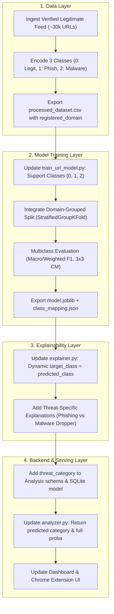

# PhishGuard – ML Training Architecture Readiness Assessment

**Assessment Date**: 2026-11-04  
**Scope**: In-depth inspection of `ml/training/dataset_pipeline.py`, `ml/training/train_url_model.py`, `ml/features/`, `ml/models/`, `backend/`, and existing test suites.  
**Objective**: Evaluate architectural readiness for production model training, three-class threat categorization, domain-leakage prevention, explainability, and backend serving.

---

## 1. Executive Summary

| Architectural Component | Current State | Readiness for 3-Class Production | Key Finding / Blocker |
|---|---|---|---|
| **URL Feature Extraction** | 20 Canonical Features | ✅ **100% Ready** | Consistent across pipeline, backend, and explainer. |
| **Dataset Preparation Pipeline** | Preserves 3 Threat Categories | ✅ **Ready** | `dataset_pipeline.py` separates `legitimate`, `phishing`, and `malware_distribution`, quarantines conflicts, and provides domain grouping. |
| **Training Pipeline (`train_url_model.py`)** | Strictly Binary (`{0, 1}`) | ❌ **Not Ready** | Hardcoded checks reject non-binary targets; metrics default to `average='binary'`. |
| **Domain-Grouped Splitting in Training** | Not Integrated in `train_url_model.py` | ❌ **Vulnerable** | Uses random `train_test_split`; leaks hostnames (`google.com`, `bit.ly`) across splits. |
| **SHAP Explainability (`explainer.py`)** | Binary TreeSHAP | ⚠️ **Partially Ready** | Fully functional for binary; hardcodes `target_class=1` and phishing-specific wording. |
| **Backend API & Database** | Binary Integer (`0`/`1`) | ⚠️ **Partially Ready** | Schema lacks `threat_category` and class probability distribution fields. |
| **Ground-Truth Legitimate Data** | 0 Verified Benign Samples | ⚠️ **Blocked by Data** | Tranco candidates are unverified. Model training must await verified benign data. |

---

## 2. Binary vs. Multiclass Classification Support

The current training pipeline in [`ml/training/train_url_model.py`](file:///c:/Users/kulka/OneDrive/Desktop/fishGuard/ml/training/train_url_model.py) is **strictly binary**.

### Code-Level Evidence:
1. **Target Validation Guard**:
   In `_load_dataset(path)` (lines 166–170):
   ```python
   unique = set(y.tolist())
   if unique != {0, 1}:
       raise ValueError(
           f"Dataset must contain both classes (0 and 1). Found: {unique}"
       )
   ```
   Providing multiclass labels (e.g. `{0, 1, 2}`) causes an immediate `ValueError`.
2. **Binary Metric Defaults**:
   In `_compute_metrics(y_true, y_pred)` (lines 185–194):
   ```python
   "precision": round(float(precision_score(y_true, y_pred, zero_division=0)), 4),
   "recall":    round(float(recall_score(y_true, y_pred, zero_division=0)), 4),
   "f1_score":  round(float(f1_score(y_true, y_pred, zero_division=0)), 4),
   ```
   Scikit-learn's `precision_score`, `recall_score`, and `f1_score` default to `average='binary'`. If passed multiclass arrays, they raise:
   `ValueError: Target is multiclass but average='binary'. Please choose another average setting...`
3. **Confusion Matrix Assumption**:
   `confusion_matrix` assumes a 2x2 shape, verified by test assertions (`assert len(cm) == 2`).

---

## 3. Feature Expectations (Canonical 20 URL Features)

The system strictly and consistently expects **exactly the 20 canonical URL features**.

### Verification Across Modules:
* **Feature Definition** ([`ml/features/url_features.py`](file:///c:/Users/kulka/OneDrive/Desktop/fishGuard/ml/features/url_features.py)):
  Defines `FEATURE_NAMES` with exactly 20 features:
  1. `url_length`, 2. `hostname_length`, 3. `num_dots`, 4. `num_hyphens`, 5. `num_underscores`, 6. `num_slashes`, 7. `num_at`, 8. `num_question_marks`, 9. `num_ampersands`, 10. `num_equals`, 11. `num_percent`, 12. `num_digits`, 13. `num_subdomains`, 14. `is_https`, 15. `has_ip_address`, 16. `has_suspicious_tld`, 17. `has_suspicious_keyword`, 18. `path_length`, 19. `query_length`, 20. `url_entropy`.
* **Dataset Preparation Pipeline** ([`ml/training/dataset_pipeline.py`](file:///c:/Users/kulka/OneDrive/Desktop/fishGuard/ml/training/dataset_pipeline.py)):
  Extracts all 20 features for verified threats in `processed_threats.csv`.
* **Model Training** ([`ml/training/train_url_model.py`](file:///c:/Users/kulka/OneDrive/Desktop/fishGuard/ml/training/train_url_model.py)):
  Validates that all 20 columns exist in the CSV header; persists `feature_names.json`.
* **Backend Inference Service** ([`backend/services/analyzer.py`](file:///c:/Users/kulka/OneDrive/Desktop/fishGuard/backend/services/analyzer.py)):
  Constructs a 1x20 numpy array matching `FEATURE_NAMES` for model inference.
* **Explainability Engine** ([`ml/explainability/explainer.py`](file:///c:/Users/kulka/OneDrive/Desktop/fishGuard/ml/explainability/explainer.py)):
  Requires 20 features and contains tailored rule templates for each feature.

---

## 4. Support for Three Threat Categories

### What Currently Supports Three Categories:
* [`ml/training/dataset_pipeline.py`](file:///c:/Users/kulka/OneDrive/Desktop/fishGuard/ml/training/dataset_pipeline.py) natively preserves three categories:
  * `legitimate` (binary label 0)
  * `phishing` (binary label 1, threat type: credential theft)
  * `malware_distribution` (binary label 1, threat type: executable droppers)
  * `unverified_candidate` (unlabeled Tranco candidates)

### What Blocks Three-Category Model Training:
1. **Lack of Verified Ground-Truth Legitimate Data**:
   The current feeds contain **0 verified legitimate samples**. Tranco is an unverified popularity list. Labeling Tranco as 0 without verification violates ground truth integrity.
2. **`train_url_model.py` Binary Enforcement**:
   As detailed in Section 2, `train_url_model.py` only accepts `{0, 1}` and evaluates binary metrics.
3. **Class Encoding Contract**:
   A three-class model requires defining an integer encoding standard:
   * Class `0`: `legitimate`
   * Class `1`: `phishing`
   * Class `2`: `malware_distribution`

---

## 5. Domain-Grouped Splitting Integration

### Status:
* **Implemented in `dataset_pipeline.py`**:
  [`split_by_registered_domain()`](file:///c:/Users/kulka/OneDrive/Desktop/fishGuard/ml/training/dataset_pipeline.py#L185-L255) groups URLs by apex registered domain (e.g., `google.com`, `bank.co.uk`) and achieves **0.00% domain leakage** across splits.
* **Missing in `train_url_model.py`**:
  [`train_url_model.py`](file:///c:/Users/kulka/OneDrive/Desktop/fishGuard/ml/training/train_url_model.py#L93-L98) relies directly on:
  ```python
  X_train, X_test, y_train, y_test = train_test_split(
      X, y,
      test_size=test_size,
      random_state=random_state,
      stratify=y,
  )
  ```
  `train_url_model.py` does not read `registered_domain` from the CSV, nor does it perform domain-grouped splitting.
* **Leakage Risk**:
  If `processed_threats.csv` or a combined dataset contains high-frequency apex domains (e.g. `google.com` with 5,555 URLs, `bit.ly` with 1,628 URLs), standard random splitting will leak domains into both train and test partitions, resulting in inflated evaluation metrics.

---

## 6. SHAP Explainability Engine Compatibility

### Current Compatibility:
* The explainer ([`ml/explainability/explainer.py`](file:///c:/Users/kulka/OneDrive/Desktop/fishGuard/ml/explainability/explainer.py)) uses `shap.TreeExplainer` on `RandomForestClassifier`.
* For a binary model predicting `0` vs `1`, it works as expected: extracts the top 5 contributing features, distinguishes positive from negative contributions, and provides human-readable explanations.

### Limitations for a Three-Class Model:
1. **Hardcoded Target Class**:
   Line 458 in `explainer.py`:
   ```python
   sample_shap = _extract_sample_shap_values(raw_shap, sample_idx=0, target_class=1)
   ```
   TreeSHAP generates SHAP values of shape `(N, 20, 3)` for a three-class model. The explainer currently hardcodes `target_class=1` (phishing), ignoring Class 0 (legitimate) and Class 2 (malware).
2. **Binary Phrasing**:
   `_generate_feature_explanation` generates explanations using binary phrasing:
   `"increases phishing risk"` vs `"decreases phishing risk (indicates legitimacy)"`.
   For malware distribution (Class 2), explanations should describe malware dropper indicators (e.g., raw IP literals, unusual ports, executable extensions).

---

## 7. Backend API & Serving Readiness

The backend API currently does **not** return threat categories.

| Layer | File | Current Behavior | Gap for Three-Class Support |
|---|---|---|---|
| **Pydantic Schema** | [`backend/schemas/analysis.py`](file:///c:/Users/kulka/OneDrive/Desktop/fishGuard/backend/schemas/analysis.py) | `prediction: Optional[int \| str] = None`<br>`risk_score: Optional[float] = None` | Lacks `threat_category` (`str`) and `class_probabilities` (`dict[str, float]`). |
| **SQLAlchemy Model** | [`backend/database/models.py`](file:///c:/Users/kulka/OneDrive/Desktop/fishGuard/backend/database/models.py) | `prediction = Column(Integer)`<br>`risk_score = Column(Float)` | No column for `threat_category` or multi-class probability breakdown. |
| **Inference Service** | [`backend/services/analyzer.py`](file:///c:/Users/kulka/OneDrive/Desktop/fishGuard/backend/services/analyzer.py) | Returns integer `pred` and `proba[1]` as scalar `risk_score`. | Does not map integers to human-readable categories (`legitimate`, `phishing`, `malware_distribution`). |
| **Dashboard** | `dashboard/app.py` | Calculates metrics assuming `0 = legitimate`, `1 = phishing`. | Cannot display three-way threat distribution without schema updates. |
| **Extension** | `extension/popup.js` | Renders binary badge (red for phishing, green for legitimate). | Needs an alert style for malware distribution (e.g., purple/orange warning). |

---

## 8. Required Changes for a Production-Ready Three-Class Model

To transition from the current binary architecture to a production-ready three-class model, the following changes are required:



### Actionable Technical Tasks:
1. **Acquire Verified Benign Ground Truth**:
   Obtain ~25,000–50,000 actively verified benign URLs (from university, government, or curated enterprise crawls) to resolve the class imbalance and avoid fabricating labels.
2. **Update `train_url_model.py`**:
   - Accept labels `0, 1, 2`.
   - Read `registered_domain` and use `StratifiedGroupKFold` or `split_by_registered_domain` to eliminate hostname leakage.
   - Use `average="macro"` and `average="weighted"` for precision/recall/F1 metrics.
   - Output per-class metrics and 3x3 confusion matrix.
3. **Enhance `explainer.py`**:
   - Set `target_class` dynamically based on the predicted class.
   - Provide distinct explanations for malware distribution indicators.
4. **Upgrade Backend & Database**:
   - Add `threat_category: Optional[str]` to `AnalysisResponse` and `Analysis` SQLAlchemy model.
   - Map predictions: `0 -> "legitimate"`, `1 -> "phishing"`, `2 -> "malware_distribution"`.
   - Update Dashboard and Chrome extension to surface all three threat categories.

---

## 9. Verification & Test Suite Results

Relevant test suites were executed to verify current system integrity:

* **Training Pipeline Tests** (`tests/test_train_url_model.py`): `16 passed`
* **Dataset Pipeline Tests** (`tests/test_dataset_pipeline.py`): `9 passed`
* **Explainability Tests** (`tests/test_explainer.py`): `23 passed`
* **Analysis API Tests** (`tests/test_analysis_api.py`): `20 passed`
* **Total Executed Tests**: **`68 passed in 11.03s`** (100% pass rate)
* **Raw Datasets & Model Files**: Preserved untouched. Zero models were trained, and no synthetic labels were created.

