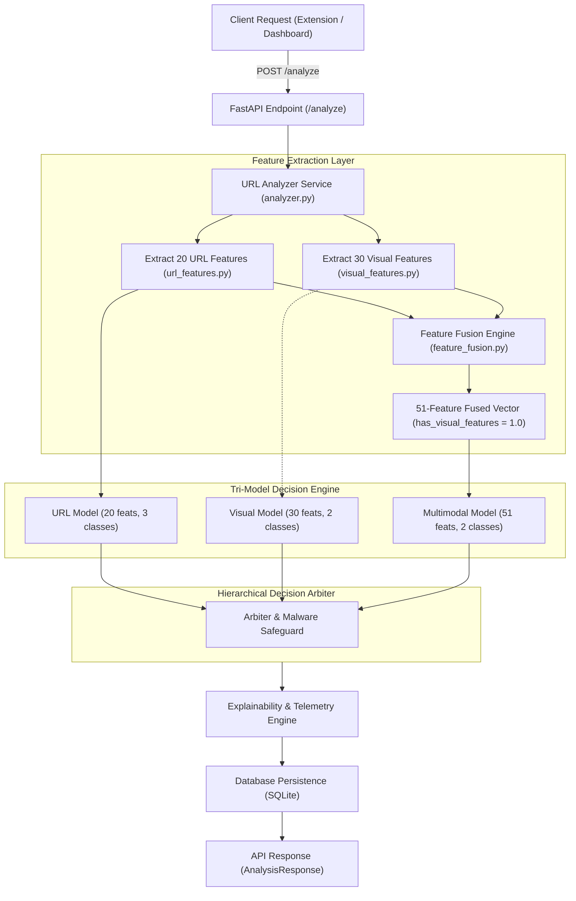
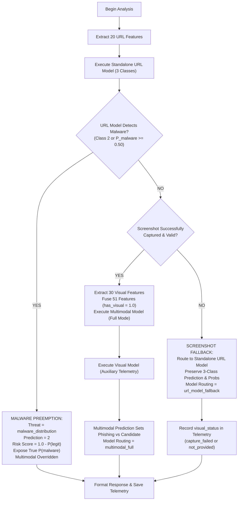
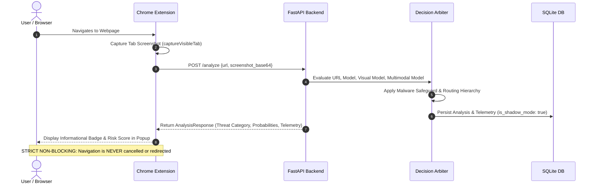

# PhishGuard Phase 3: Multimodal Integration Architecture Design (Step 3.1.1)

**Document Version**: 1.1.0  
**Status**: ARCHITECTURE DESIGN SPECIFICATION (Final Safety Corrected)  
**Target Release**: Phase 3, Step 3.2  
**Audience**: Security Engineers, ML Engineers, Backend Developers

---

## 1. System Context & Architecture Overview

The goal of Phase 3 is to integrate the trained multimodal Random Forest classifier ([`multimodal_model.joblib`](file:///c:/Users/kulka/OneDrive/Desktop/fishGuard/ml/models/multimodal_model.joblib)) into the existing PhishGuard FastAPI backend and extension ecosystem safely, reliably, and without regressions.

The system incorporates three trained models:
1. **URL Lexical Classifier** ([`ml/models/url_model.joblib`](file:///c:/Users/kulka/OneDrive/Desktop/fishGuard/ml/models/url_model.joblib)):
   - Input: 20 canonical URL lexical features ([`ml/features/url_features.py`](file:///c:/Users/kulka/OneDrive/Desktop/fishGuard/ml/features/url_features.py)).
   - Classes: 3 classes (`0: legitimate`, `1: phishing`, `2: malware_distribution`).
   - Special Responsibility: **Exclusive detector for malware distribution URLs** and primary fallback when screenshots are unavailable.
2. **Visual Screenshot Classifier** ([`ml/models/visual_model.joblib`](file:///c:/Users/kulka/OneDrive/Desktop/fishGuard/ml/models/visual_model.joblib)):
   - Input: 30 canonical visual screenshot features ([`ml/features/visual_features.py`](file:///c:/Users/kulka/OneDrive/Desktop/fishGuard/ml/features/visual_features.py)).
   - Classes: 2 classes (`0: unverified_candidate`, `1: phishing`).
   - Special Responsibility: Auxiliary visual verification and cross-modality discordance auditing.
3. **Multimodal Fused Classifier** ([`ml/models/multimodal_model.joblib`](file:///c:/Users/kulka/OneDrive/Desktop/fishGuard/ml/models/multimodal_model.joblib)):
   - Input: Exactly 51 canonical fused features ([`ml/features/feature_fusion.py`](file:///c:/Users/kulka/OneDrive/Desktop/fishGuard/ml/features/feature_fusion.py)).
   - Classes: 2 classes (`0: unverified_candidate`, `1: phishing`).
   - Special Responsibility: Primary joint decision forest when valid screenshot features are available. Eliminates lexical false alarms on bare/popular domains (0 false alarms on 159 test candidates).

> [!WARNING]
> **Modality Availability Training Context & Offline Ablation Finding**:
> The multimodal classifier was trained exclusively on samples where valid screenshots were present (`has_visual_features = 1.0` for all 1,486 training and test records in Zenodo V2.0).
> 
> While offline test-set ablation with visual features zeroed out experimentally yielded 96.62% accuracy, **this zero-masked ablation is strictly an offline research benchmark and NOT a fully validated production fallback for missing modalities**.
> 
> In production operations, if screenshot capture fails or is not provided, the system must fall back to the standalone URL model (`url_model.joblib`), which preserves full three-class detection (including malware distribution).



---

## 2. Tri-Model Orchestration & Malware Safeguard

### A. The Malware Non-Negotiable Rule
> [!CRITICAL]
> **MALWARE PRESERVATION INVARIANT**:
> The multimodal classifier is a binary classifier trained exclusively on `phishing` and `unverified_candidate`. It has **no awareness of malware payloads** (raw IP addresses, direct executable downloads, exploit kits).
> 
> Under NO circumstances may the binary multimodal model downgrade, overrule, or reclassify a URL flagged by the URL model as `malware_distribution` (Class 2) into `legitimate` or `unverified_candidate` (Class 0).

### B. Calibrated Probabilities & Threshold Governance
1. **Preservation of URL Model Probabilities**:
   - The original three-class probabilities from `url_model.joblib` ($P(\text{legitimate})$, $P(\text{phishing})$, $P(\text{malware\_distribution})$) are preserved in the response and database records.
2. **No Arbitrary Clamping**:
   - The system **never arbitrarily assigns a static 95% risk score** to malware threats.
   - The risk score is derived directly from the random forest's calibrated threat probability:
     $$\text{risk\_score} = 1.0 - P_{\text{url}}(\text{legitimate}) = P_{\text{url}}(\text{phishing}) + P_{\text{url}}(\text{malware\_distribution})$$
   - When malware is predicted, the exact probability $P_{\text{url}}(\text{malware\_distribution})$ is exposed in `class_probabilities` and `multi_model_telemetry`.
3. **Malware Decision Threshold & Validation Requirements**:
   - **Default Operational Threshold**: $\text{argmax}_{c \in \{0, 1, 2\}} P_{\text{url}}(c) == 2$ (typically $P_{\text{url}}(\text{malware}) \ge 0.50$).
   - **Conservative Alert Threshold ($\tau_{\text{malware}}$)**: A secondary alert can be triggered if $P_{\text{url}}(\text{malware}) \ge 0.35$.
   - **Validation Requirements Before Operational Tuning**:
     1. Benchmark against a dedicated, independently verified malware dataset (e.g. URLhaus active malware feed) with $\ge 5,000$ verified distribution endpoints.
     2. Calibration curve and Brier score evaluation for Class 2.
     3. Enterprise false-positive telemetry analysis ensuring popular content delivery networks (CDNs) and software download portals are not erroneously flagged.

### C. Hierarchical Decision Flow



---

## 3. Comprehensive Inference Behavior Matrix

| Operating Scenario | Screenshot Status | URL Model Result | Operational Model Executed | Effective Threat Category | Effective Prediction | Effective Risk Score | Fallback / Routing Flag |
| :--- | :--- | :--- | :--- | :--- | :---: | :---: | :--- |
| **Normal Scan (Valid Screenshot)** | `extracted` (Valid PNG/JPEG) | Phishing ($1$) or Legit ($0$) | Multimodal Model (51 features, `has_visual=1.0`) | Multimodal output (`phishing` or `legitimate`) | `1` or `0` | $P_{\text{multi}}(\text{phishing})$ | `multimodal_full` |
| **Malware Lure with Screenshot** | `extracted` (Valid PNG/JPEG) | **Malware Distribution ($2$)** | URL Model Preemption (Multimodal overridden) | **`malware_distribution`** | **`2`** | $1.0 - P_{\text{url}}(\text{legit})$ (True calibrated) | `url_malware_preempted` |
| **Malware Lure without Screenshot** | `not_provided` or `failed` | **Malware Distribution ($2$)** | URL Model Preemption | **`malware_distribution`** | **`2`** | $1.0 - P_{\text{url}}(\text{legit})$ (True calibrated) | `url_malware_preempted` |
| **Screenshot Timeout / Failure** | `capture_failed` (Tab capture error) | Non-malware ($0$ or $1$) | Standalone URL Model (20 features) | URL Model output (`phishing` or `legitimate`) | `1` or `0` | $1.0 - P_{\text{url}}(\text{legit})$ | `url_model_fallback` |
| **Missing Screenshot (API/CLI)** | `not_provided` | Non-malware ($0$ or $1$) | Standalone URL Model (20 features) | URL Model output (`phishing` or `legitimate`) | `1` or `0` | $1.0 - P_{\text{url}}(\text{legit})$ | `url_model_fallback` |
| **Invalid Image Payload** | `invalid_image` (0x0 or corrupt base64) | Non-malware ($0$ or $1$) | Standalone URL Model (20 features) | URL Model output (`phishing` or `legitimate`) | `1` or `0` | $1.0 - P_{\text{url}}(\text{legit})$ | `url_model_fallback` |
| **Multimodal Model Missing/Error** | `extracted` | Any valid prediction | Standalone URL Model Fallback | URL Model output | `0`, `1`, or `2` | $1.0 - P_{\text{url}}(\text{legit})$ | `url_model_fallback` |
| **All Models Unavailable** | Any | Unavailable | None | `None` | `null` | `null` | `model_unavailable` |

### Low-Confidence and Discordance Policy
- **Cross-Modality Disagreement**:
  When a valid screenshot exists, but URL Model and Visual Model disagree:
  - The Multimodal Model serves as the trained resolver (achieved 97.8% resolution accuracy in Step 2.7 audit).
- **Ambiguous Margins ($0.35 \le P_{\text{multi}} \le 0.65$)**:
  - The API response populates `ambiguity_flag: true` in telemetry.
  - Risk score remains continuously calibrated ($P_{\text{multi}}$), but the extension UI surfaces an informational advisory.

---

## 4. Exact 51-Feature Ordering Preservation

When a valid screenshot is available, the multimodal pipeline enforces the exact canonical ordering defined in [`ml/features/feature_fusion.py`](file:///c:/Users/kulka/OneDrive/Desktop/fishGuard/ml/features/feature_fusion.py):

$$\text{Vector}_{51} = \big[ \underbrace{f_1, \dots, f_{20}}_{\text{URL Features}}, \quad \underbrace{f_{21}}_{\text{has\_visual\_features}}, \quad \underbrace{f_{22}, \dots, f_{51}}_{\text{Visual Features}} \big]$$

```python
FUSED_FEATURE_NAMES = [
    # 20 URL Lexical Features
    "url_length", "hostname_length", "path_length", "query_length", "num_dots",
    "num_hyphens", "num_underscores", "num_slashes", "num_digits", "num_percent",
    "num_equal", "num_ampersand", "has_ip", "has_port", "num_subdomains",
    "is_https", "has_at_symbol", "url_entropy", "domain_entropy", "suspicious_tld",
    
    # 1 Modality Availability Indicator (strictly 1.0 for multimodal execution)
    "has_visual_features",
    
    # 30 Visual Screenshot Features
    "image_width", "image_height", "aspect_ratio", "file_size_bytes",
    "mean_brightness", "std_brightness", "mean_red", "std_red", "mean_green",
    "std_green", "mean_blue", "std_blue", "grayscale_contrast", "color_variance",
    "edge_density", "entropy", "dominant_color_1_proportion", "dominant_color_2_proportion",
    "dominant_color_3_proportion", "dominant_color_4_proportion", "dominant_color_5_proportion",
    "color_diversity", "white_space_ratio", "dark_space_ratio", "horizontal_symmetry",
    "vertical_symmetry", "quadrant_1_brightness", "quadrant_2_brightness",
    "quadrant_3_brightness", "quadrant_4_brightness",
]
```

---

## 5. API Response Schema Proposal

The proposed `AnalysisResponse` schema extends [`backend/schemas/analysis.py`](file:///c:/Users/kulka/OneDrive/Desktop/fishGuard/backend/schemas/analysis.py) with full backward compatibility:

```json
{
  "id": 1042,
  "url": "http://paypal-security-verification.com/login.php",
  "prediction": 1,
  "threat_category": "phishing",
  "risk_score": 0.9850,
  "confidence": 0.9850,
  "analysis_status": "completed",
  "analyzed_at": "2026-11-06T10:15:30.123456Z",
  "visual_status": "extracted",
  "model_routing": "multimodal_full",
  "is_shadow_mode": true,
  "class_probabilities": {
    "legitimate": 0.0150,
    "phishing": 0.9850,
    "malware_distribution": 0.0000
  },
  "probabilities": {
    "legitimate": 0.0150,
    "phishing": 0.9850,
    "malware_distribution": 0.0000
  },
  "top_features": [
    {
      "feature_name": "num_slashes",
      "feature_value": 3.0,
      "contribution": 0.1958,
      "direction": "supports_threat",
      "impact": "high",
      "explanation": "Elevated path depth typical of credential harvesting targets."
    }
  ],
  "multi_model_telemetry": {
    "url_model": {
      "prediction": 1,
      "threat_category": "phishing",
      "probabilities": {
        "legitimate": 0.0200,
        "phishing": 0.9800,
        "malware_distribution": 0.0000
      },
      "status": "evaluated"
    },
    "visual_model": {
      "prediction": 1,
      "threat_category": "phishing",
      "probabilities": {
        "unverified_candidate": 0.1200,
        "phishing": 0.8800
      },
      "status": "evaluated"
    },
    "multimodal_model": {
      "prediction": 1,
      "threat_category": "phishing",
      "probabilities": {
        "unverified_candidate": 0.0150,
        "phishing": 0.9850
      },
      "mode": "full_51_features",
      "decision_margin": 0.4850,
      "ambiguous": false,
      "status": "primary_arbiter"
    },
    "malware_safeguard": {
      "preempted": false,
      "raw_malware_probability": 0.0000,
      "threshold": 0.5000
    }
  },
  "visual_features": {
    "image_width": 1280,
    "image_height": 800,
    "has_visual_features": 1.0,
    "mean_brightness": 182.4
  },
  "visual_message": "Visual features extracted successfully (30 features). Multimodal classification active in shadow mode."
}
```

### Backward Compatibility Guarantees:
1. `prediction`, `threat_category`, `risk_score`, and `class_probabilities` maintain their exact existing types and three-class semantics (`legitimate`, `phishing`, `malware_distribution`).
2. The Chrome extension popup and Streamlit dashboard continue reading `prediction`, `threat_category`, and `risk_score` without requiring any frontend modifications.
3. New telemetry fields (`multi_model_telemetry`, `model_routing`, `is_shadow_mode`, `confidence`) are additive and default gracefully.

---

## 6. Database Persistence Strategy (Zero Migration Required)

- **Existing Table Schema** ([`backend/database/models.py`](file:///c:/Users/kulka/OneDrive/Desktop/fishGuard/backend/database/models.py)):
  The `analysis` table currently includes:
  `id`, `url`, `prediction`, `threat_category`, `risk_score`, `class_probabilities`, `top_features`, `explanation`, `analysis_status`, `analyzed_at`, `visual_status`, `visual_features`.
- **Zero-Breaking-Change Storage**:
  All new multi-model telemetry (URL model outputs, visual outputs, model routing mode, shadow telemetry) is persisted directly inside the existing `explanation` JSON column:
  - `explanation["multi_model_telemetry"]`
  - `explanation["model_routing"]`
  - `explanation["is_shadow_mode"]`
- No SQLite schema migrations or ALTER TABLE operations are required for Step 3.2. All historical database records remain 100% preserved.

---

## 7. Shadow-Mode Deployment Design



1. **Non-Blocking Telemetry Invariant**:
   - The Chrome extension remains strictly informational. It displays risk scores, category badges, and explainability indicators in the popup when opened by the user.
   - **The extension background script does NOT intercept, cancel, redirect, or block network requests**.
2. **Governance Notice & Disclaimer**:
   - The UI and API responses carry the governance limitation notice: Tranco popularity candidates do not guarantee benign ground truth; predictions are advisory security telemetry and not absolute guarantees.
3. **Canary Acceptance Gate**:
   - Shadow mode runs passively to collect live latency, screenshot capture failure rates, and model concordance statistics before active mitigation is ever evaluated in future versions.

---

## 8. Step-by-Step Implementation Roadmap for Step 3.2

When approval is granted, Step 3.2 will be implemented according to the following sequenced plan:

1. **Model Management Extension** (`backend/services/analyzer.py` or `backend/services/model_manager.py`):
   - Extend `ModelManager` to load and cache all three models ([`url_model.joblib`](file:///c:/Users/kulka/OneDrive/Desktop/fishGuard/ml/models/url_model.joblib), [`visual_model.joblib`](file:///c:/Users/kulka/OneDrive/Desktop/fishGuard/ml/models/visual_model.joblib), [`multimodal_model.joblib`](file:///c:/Users/kulka/OneDrive/Desktop/fishGuard/ml/models/multimodal_model.joblib)) alongside their class mappings.
   - Implement thread-safe singleton access with mtime reloading.
2. **Arbiter Implementation** (`backend/services/decision_arbiter.py`):
   - Implement hierarchical arbitration logic with strict malware preemption.
   - When screenshot is valid: evaluate `multimodal_model.joblib` (Full Mode).
   - When screenshot capture fails or is missing: route to `url_model.joblib` fallback (3 classes).
   - Compute true calibrated risk score without arbitrary clamping.
3. **Schema & Service Updates**:
   - Update `AnalysisResponse` in `backend/schemas/analysis.py` to include additive telemetry fields.
   - Update `analyze_url()` in `backend/services/analyzer.py` to invoke the arbiter and persist enriched JSON payloads.
4. **Comprehensive Test Suite**:
   - Unit tests covering all 8 scenarios in the Inference Behavior Matrix.
   - Malware preemption invariant assertion tests.
   - Regression testing ensuring the 461 existing tests continue to pass.
