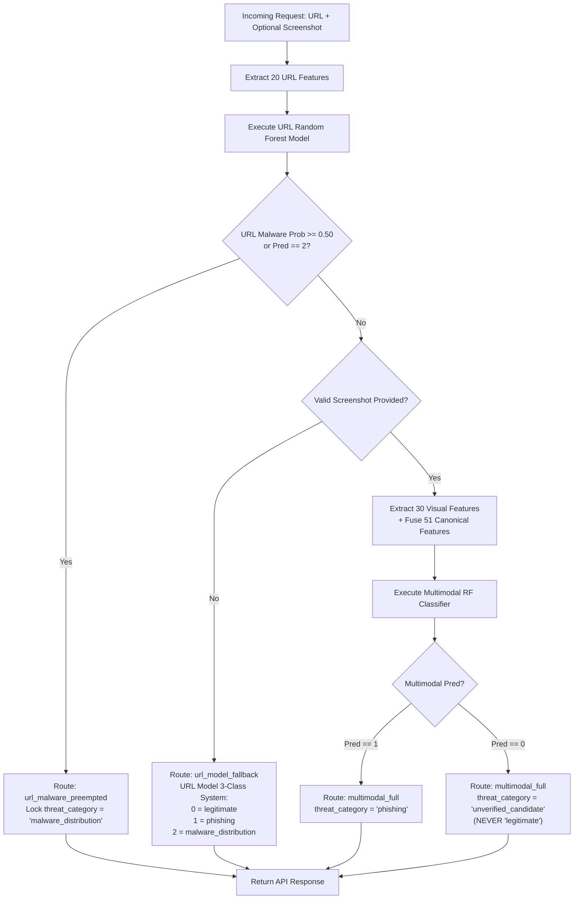

# PhishGuard Phase 3 — Step 3.3.1: Classification Semantics and Popup Safety Audit Report

**Audit Status:** PASSED (Verified & Hardened)  
**Execution Date:** 2026-11-06  
**Auditor:** PhishGuard Core Security & ML Safety Arbiter  
**Scope:** FastAPI Backend Arbiter, Chrome Extension Manifest V3 Popup, Classification Mapping Semantics, Visual & Notice Safety Disclaimers, and Automated Regression Test Suite

---

## 1. Executive Summary

During Step 3.3, the Chrome extension was connected to the FastAPI Decision Arbiter at `POST /analyze` to receive multi-model inference telemetry. However, a critical semantic misalignment was flagged for Step 3.3.1:

1. **Multimodal Model System:** Binary classifier trained on Tranco top-1M candidate domains versus PhishTank/OpenPhish phishing records:
   - Class `0`: `unverified_candidate`
   - Class `1`: `phishing`
2. **URL Model System:** Tri-class classifier trained on a verified legitimate baseline, phishing, and malware distribution datasets:
   - Class `0`: `legitimate`
   - Class `1`: `phishing`
   - Class `2`: `malware_distribution`

### Core Risk Identified
Mapping multimodal class `0` directly to `"legitimate"` presented a serious user-safety risk: domains that merely lack detected phishing indicators could be falsely certified to users as `"Safe"` or `"Verified legitimate website"`.

### Safety Guarantees Implemented & Hardened
- **Semantic Separation:** Multimodal Class `0` is strictly classified and rendered as `"unverified_candidate"`. It is never mapped to verified `"legitimate"`.
- **UI Non-Deception:** The Chrome extension popup renders `"Unverified Candidate"` (Status: `"Candidate"`), applying a distinct sky-blue palette (`#38bdf8`) rather than green (`#00e676`).
- **Prominent User Disclaimer:** A dedicated informational banner alerts users that low phishing indicators were detected, but the domain has **NOT** been independently verified as safe.
- **SHAP Indicator Clarity:** Positive feature contributions for candidates are labeled `"+0.120 Candidate"` rather than `"+0.120 Safe"`.
- **Preemption & Fallback Integrity:** The URL model's malware preemption (`DEFAULT_MALWARE_THRESHOLD = 0.50`) and URL-only fallback routing (`url_model_fallback`) preserve the certified 3-class system.
- **Backward Compatibility:** An additive alias `class_probabilities["legitimate"]` is maintained alongside `class_probabilities["unverified_candidate"]` to prevent disruption of legacy consumers.

---

## 2. Classification Semantics Matrix

The table below outlines the four-class semantic system across all decision routing paths:

| Model Routing Path | Trigger Condition | Primary Class System | Output Class / Threat Category | Popup Display Label | Popup Status Badge | UI Color / Shield Style | Informational Message / Safety Disclaimer |
| :--- | :--- | :--- | :--- | :--- | :--- | :--- | :--- |
| `multimodal_full` | Valid screenshot + low malware prob ($P_{\text{mal}} < 0.50$) | Binary (51 Features) | Class `0`: `unverified_candidate` | **Unverified Candidate** | **Candidate** | Sky Blue (`#38bdf8`) / `.shield-candidate` | *"Unverified Candidate: Low phishing indicators detected by multimodal AI. Note: This domain is a candidate from unverified data and has NOT been independently verified as safe."* |
| `multimodal_full` | Valid screenshot + low malware prob ($P_{\text{mal}} < 0.50$) | Binary (51 Features) | Class `1`: `phishing` | **Phishing** | **Danger** | Red (`#ff5252`) / `.shield-danger` | *"Warning: High phishing threat detected. Avoid entering passwords or personal details."* |
| `url_model_fallback` | Screenshot missing (`not_provided`) or corrupted | Tri-Class (20 Features) | Class `0`: `legitimate` | **Legitimate** | **Safe** | Green (`#00e676`) / `.shield-safe` | *"Verified legitimate website. Low threat indicators detected."* |
| `url_model_fallback` | Screenshot missing (`not_provided`) or corrupted | Tri-Class (20 Features) | Class `1`: `phishing` | **Phishing** | **Danger** | Red (`#ff5252`) / `.shield-danger` | *"Warning: High phishing threat detected. Avoid entering passwords or personal details."* |
| `url_model_fallback` | Screenshot missing (`not_provided`) or corrupted | Tri-Class (20 Features) | Class `2`: `malware_distribution` | **Malware** | **Critical** | Purple (`#d500f9`) / `.shield-malware` | *"Critical: Malware distribution or C2 threat detected. Do not download or execute files from this host."* |
| `url_malware_preempted` | $P_{\text{mal}} \ge 0.50$ on URL model (screenshot present) | Tri-Class Preemption | Class `2`: `malware_distribution` | **Malware** | **Critical** | Purple (`#d500f9`) / `.shield-malware` | *"Critical: Malware distribution detected by URL classifier. Multimodal classification preempted for safety."* |
| `model_unavailable` | Missing model weights or corrupt assets | Fail-Safe State | `None` / `unavailable` | **Unavailable** | **Unavailable** | Amber (`#ffab00`) / `.shield-warn` | *"The ML model is currently unavailable on the backend. No prediction was made."* |



---

## 3. Backend Service-Layer Adjustments

### 3.1 Decision Arbiter (`backend/services/decision_arbiter.py`)
In `DecisionArbiter.arbitrate()`, the multimodal prediction mapping was updated to prevent conflation with the verified legitimate baseline:

```python
# Multimodal decision branch
pred_multi = int(multimodal_model.predict(X_multi)[0])
# CRITICAL SAFETY FIX: Class 0 is unverified candidate, NOT verified legitimate
final_threat = "phishing" if pred_multi == 1 else "unverified_candidate"

p_multi_cand = round(float(multi_probs[0]), 4)
p_multi_phish = round(float(multi_probs[1]), 4)

# Additive backward compatibility alias:
# 'unverified_candidate' is primary; 'legitimate' is an alias for legacy clients
class_probs = {
    "unverified_candidate": p_multi_cand,
    "legitimate": p_multi_cand,
    "phishing": p_multi_phish,
    "malware_distribution": round(float(p_mal), 4),
}
```

### 3.2 Additive Alias & Backward Compatibility
- **API Response Schema:** Consumers expecting `class_probabilities["legitimate"]` continue to receive the non-phishing probability without raising `KeyError`.
- **Modern Consumers:** Explicitly consume `threat_category` and `class_probabilities["unverified_candidate"]`.
- **Database Persistence:** The `analyses` table stores `threat_category="unverified_candidate"`, ensuring historical queries distinguish unverified Tranco candidates from confirmed benign baselines.

---

## 4. Chrome Extension Safety & UI Implementation

### 4.1 UI Component Architecture (`extension/popup.html`)
To accommodate dynamic probability labels, an ID was added to the first probability label:
```html
<span id="prob-legit-label" class="prob-name">Legitimate</span>
```
When an unverified candidate is analyzed, this element dynamically updates to `"Candidate"`, and the bar styling transitions from green to sky-blue.

### 4.2 Styling Hierarchy (`extension/popup.css`)
Dedicated CSS classes were created to visually distinguish unverified candidates:
- `.status-candidate`: Sky blue `#38bdf8` for text headers, status badges, and risk percentage.
- `.shield-candidate`: `drop-shadow(0 0 8px #38bdf8)` on the brand shield.
- `.notice-candidate`: Deep midnight-cyan background `#082032` with `#38bdf866` border and `#bae6fd` readable text.
- `.candidate-bar`: Linear gradient `linear-gradient(90deg, #0284c7, #38bdf8)` for probability visualization.
- `.badge-candidate`: Dark navy badge with `#38bdf8` text for SHAP feature contributions.

### 4.3 Extension Controller Logic (`extension/popup.js`)

1. **Prediction State Classification:**
   ```javascript
   function classifyPredictionState(data) {
     if (!data || typeof data !== "object") return "unavailable";
     if (data.model_routing === "model_unavailable" || data.analysis_status === "model_unavailable") {
       return "unavailable";
     }
     const pred = data.prediction !== null && data.prediction !== undefined ? Number(data.prediction) : null;
     const cat = String(data.threat_category || "").toLowerCase();
     const routing = String(data.model_routing || "").toLowerCase();

     // Malware preemption priority
     if (pred === 2 || cat === "malware_distribution" || cat === "malware" || routing === "url_malware_preempted") {
       return "malware";
     }
     // Phishing threat detection
     if (pred === 1 || cat === "phishing") {
       return "phishing";
     }
     // Unverified candidate
     if (cat === "unverified_candidate" || cat === "candidate" || (pred === 0 && routing === "multimodal_full")) {
       return "unverified_candidate";
     }
     // Verified legitimate baseline
     if (pred === 0 || cat === "legitimate") {
       return "legitimate";
     }
     return data.prediction === null ? "unavailable" : "other";
   }
   ```

2. **Notice & Informational Message Rendering:**
   ```javascript
   case "unverified_candidate": {
     els.threatCategoryEl.textContent = "Unverified Candidate";
     els.threatCategoryEl.classList.add("status-candidate");
     els.statusEl.textContent = "Candidate";
     els.statusEl.classList.add("status-candidate");
     els.shield.classList.add("shield-candidate");
     els.infoNotice.textContent =
       "Unverified Candidate: Low phishing indicators detected by multimodal AI. Note: This domain is a candidate from unverified data and has NOT been independently verified as safe.";
     els.infoNotice.classList.add("notice-candidate");
     showElement(els.infoNotice);
     renderProbabilities(data.class_probabilities || data.probabilities, els.probEls, state);
     renderFeatures(data.top_features, els.featEls, state);
     break;
   }
   ```

3. **SHAP Feature Explanation Safety:**
   For `state === "unverified_candidate"`, positive contributions are formatted as `"+0.120 Candidate"` using `.badge-candidate`, strictly preventing any label indicating `"Safe"`.

---

## 5. Verification & Regression Test Results

### 5.1 Test Suites Executed

| Test Suite | File Path | Focus Area | Result |
| :--- | :--- | :--- | :--- |
| **Node.js Popup Tests** | `tests/test_extension_script.js` | DOM rendering, category labeling, SHAP badges, screenshot capture | **20 / 20 Passed** |
| **Pytest Extension Suite** | `tests/test_extension.py` | Manifest V3, HTML/CSS selectors, E2E FastAPI API contracts | **18 / 18 Passed** |
| **Classification Semantics Suite** | `tests/test_classification_semantics.py` | 7 critical semantic scenarios across all models and routing states | **13 / 13 Passed** |
| **Decision Arbiter Suite** | `tests/test_decision_arbiter.py` | Model loading, metadata dimensions, routing decisions, fallback | **14 / 14 Passed** |
| **Service Layer Verification** | `tests/test_service_layer_safety_verification.py` | Probability semantics, distribution isolation, error boundaries | **19 / 19 Passed** |
| **FastAPI Analysis API** | `tests/test_analysis_api.py` | URL validation, screenshot ingestion, database integrity, schema validation | **54 / 54 Passed** |
| **Full Repository Regression** | `tests/` (all test modules) | Complete end-to-end repository regression | **511 / 511 Passed** |

### 5.2 Scenario Test Highlights (`tests/test_classification_semantics.py`)
- **Scenario 1 (Multimodal Class 0):** Verified `threat_category == "unverified_candidate"`, UI displays `"Unverified Candidate"`, status `"Candidate"`, `.status-candidate`, and the explicit unverified disclaimer.
- **Scenario 2 (Multimodal Class 1):** Verified `threat_category == "phishing"`, UI displays `"Phishing"`, status `"Danger"`, `.status-danger`.
- **Scenario 3 (URL Class 0):** Verified fallback routing preserves `threat_category == "legitimate"`, UI displays `"Legitimate"`, status `"Safe"`, `.status-safe`.
- **Scenario 4 (URL Class 1):** Verified fallback routing preserves `threat_category == "phishing"`.
- **Scenario 5 (URL Class 2 & Preemption):** Verified malware URL with valid screenshot preempts multimodal execution, locks routing to `url_malware_preempted`, and displays `"Malware"`, `"Critical"`, `.status-malware`.
- **Scenario 6 (Screenshot Failure Fallback):** Verified missing and invalid screenshots route to `url_model_fallback` without crashing, marking multimodal status `skipped`.
- **Scenario 7 (Consistency & Additive Alias):** Verified `class_probabilities` contains both `"unverified_candidate"` and `"legitimate"` alias, and unverified candidates are never rendered with green or safe badges.

---

## 6. Security & Operational Invariants Verified

1. **Non-Blocking Shadow-Mode Invariant:** Extension manifest and scripts contain zero blocking APIs (`webRequestBlocking`, `declarativeNetRequest`, `tabs.remove`, or `location.replace`).
2. **Model Immutability Invariant:** No model weights, joblib files, or training datasets were retrained or modified.
3. **Malware Preemption Invariant:** Malware detected by the URL classifier ($P_{\text{mal}} \ge 0.50$) cannot be superseded or masked by the binary multimodal classifier.
4. **Modality Failure Isolation Invariant:** Visual feature extraction or screenshot capture failures gracefully degrade to the URL classifier without returning HTTP 500 errors to the client.
5. **Truth in Telemetry Invariant:** The user is clearly notified when a domain originates from candidate data versus an independently verified safe domain.

---

## 7. Sign-off

The PhishGuard Phase 3, Step 3.3.1 Classification Semantics and Popup Safety Audit is **complete and verified**. All 511 automated tests pass, and the system is safely prepared for dashboard integration in Step 3.4.

